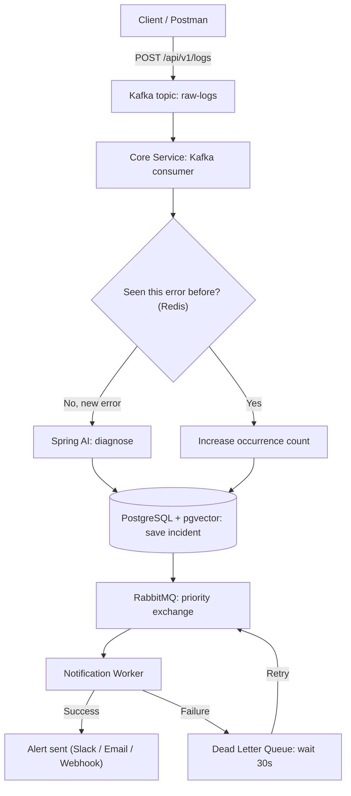
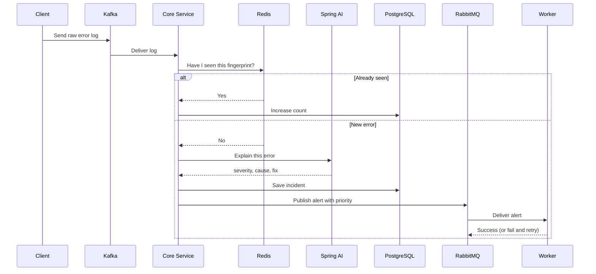
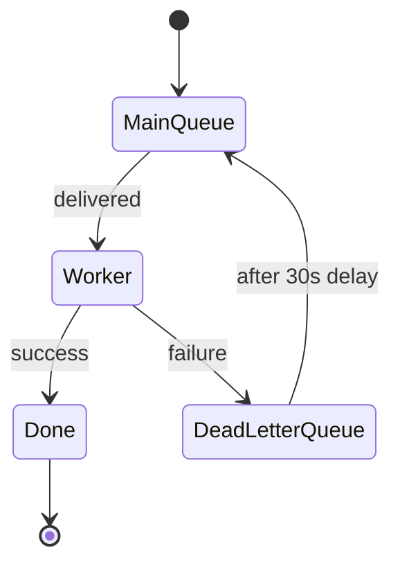

# SentinelAI

**An AI-assisted incident triage and alerting backend.**
Applications send error logs in. SentinelAI filters out repeats, asks an AI to explain *new* errors, and delivers alerts
to the right people by priority.

---

## The problem

Production systems throw thousands of errors a minute. Most are the same error repeated. 
Engineers waste time reading duplicates, and calling an AI for every one would be slow and expensive.

## The idea

1. **Collect** logs at high speed.
2. **Skip repeats** by remembering what was already seen.
3. **Diagnose** only new errors with an AI (severity, probable cause, suggested fix).
4. **Deliver** alerts by priority, and retry automatically when delivery fails.

---

## How it works



### One log, start to finish



### What happens when delivery fails



---

## Tech stack

| Technology                    | Role                          | Why it's here                                               |
|-------------------------------|-------------------------------|-------------------------------------------------------------|
| **Java 21, Spring Boot 4**    | Both services                 | Main application framework                                  |
| **Apache Kafka** (KRaft mode) | Log ingestion                 | A fast, replayable stream for high-volume logs              |
| **Redis**                     | Deduplication                 | Quickly remembers error fingerprints so repeats skip the AI |
| **Spring AI**                 | AI diagnosis                  | Calls an LLM and returns a typed Java object                |
| **PostgreSQL + pgvector**     | Storage and similarity search | Stores incidents and finds similar past ones                |
| **RabbitMQ**                  | Alert delivery                | Priority queues, routing and automatic retries              |
| **Docker Compose**            | Local setup                   | Starts all infrastructure with one command                  |

> **Why both Kafka and RabbitMQ?**
> Kafka is a durable log, good for a huge flow of events that may need replaying.
> RabbitMQ is a task router, good for priorities, routing rules and retries.
> Each does the job it is best at.

---

## Services

| Service                        | Port | Responsibility                                                               |
|--------------------------------|------|------------------------------------------------------------------------------|
| `sentinel-core-service`        | 8080 | Receives logs, deduplicates, calls the AI, saves incidents, publishes alerts |
| `sentinel-notification-worker` | 8081 | Consumes alerts by priority, sends them, retries failures                    |
| `sentinel-common`              | n/a  | Shared records (`RawLogEvent`, `IncidentAlertPayload`) used by both services |

### Key concepts

- **Fingerprint:** a SHA-256 hash of `exceptionType + first stack-trace line`. Identical errors produce the same hash.
- **Priority:** alerts are `CRITICAL`, `HIGH` or `LOW`. Critical alerts are delivered first.
- **Dead Letter Exchange (DLX):** a holding area for failed messages. They wait, then return for another attempt.
- **Multi-tenant:** each request carries an `X-Tenant-Id` header so incidents stay separated per client.

---

## Getting started

### Prerequisites

- Java 21
- Maven
- Docker and Docker Compose
- An API key for an LLM provider (or a local model through Ollama)

### Run it

```bash
# 1. Clone the repository
git clone https://github.com/reonfernandes/sentinelai-incident-triage
cd sentinelai-incident-triage

# 2. Start Kafka, Redis, PostgreSQL and RabbitMQ
docker compose up -d

# 3. Start the services (two terminals)
mvn -pl sentinel-core-service spring-boot:run
mvn -pl sentinel-notification-worker spring-boot:run
```

### Try it

```bash
curl -X POST http://localhost:8080/api/v1/logs \
  -H "Content-Type: application/json" \
  -H "X-Tenant-Id: acme-corp" \
  -d '{
        "service": "payment-service",
        "exceptionType": "NullPointerException",
        "stackTrace": "PaymentService.java:42",
        "message": "Cannot read customer id"
      }'
```

Send the same request twice. The first is diagnosed by the AI. The second is caught by Redis, and the console shows a cache hit.

### Useful dashboards

| Tool                | URL                                   |
|---------------------|---------------------------------------|
| Swagger UI          | http://localhost:8080/swagger-ui.html |
| RabbitMQ Management | http://localhost:15672                |

---

## Project structure

```text
sentinelai/
├── sentinel-common/                # Shared records
├── sentinel-core-service/          # Ingestion, dedup, AI, storage, publishing
├── sentinel-notification-worker/   # Alert delivery and retries
├── docker-compose.yml              # Local infrastructure
└── README.md
```

---

## Roadmap

- [x] Project design
- [x] Log ingestion through Kafka
- [x] Redis deduplication
- [x] AI diagnosis with Spring AI
- [ ] Incident storage in PostgreSQL
- [ ] RabbitMQ priority queues and retry logic
- [ ] Similar-incident search with pgvector
- [ ] API Gateway
- [ ] Metrics with Micrometer and Prometheus

---

## What I learned

- Combining a stream (Kafka) with a task router (RabbitMQ) and knowing when each fits
- Cutting AI cost by caching repeated errors
- Making delivery reliable with dead letter queues and retries
- Getting structured, typed output from an LLM

---

## Author

**Reon Fernandes**, Backend Java Developer
GitHub: [github.com/reonfernandes](https://github.com/reonfernandes)